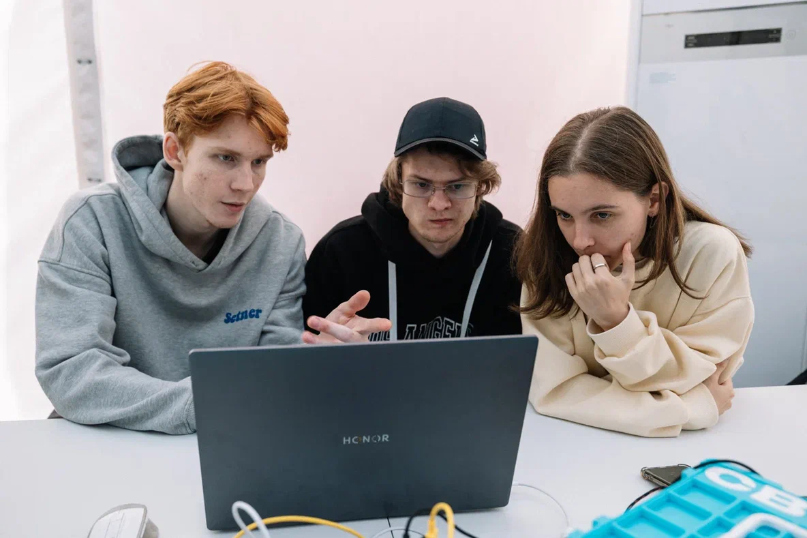
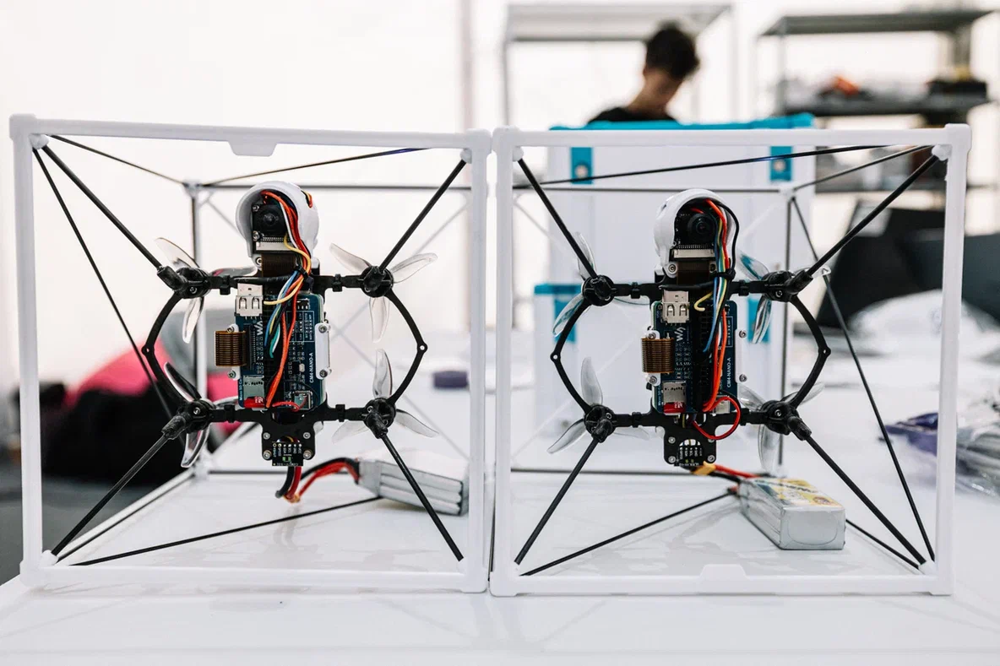
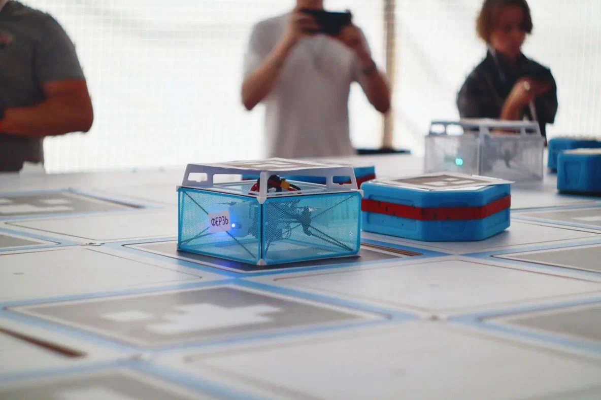

# Ход Дрона: Шахматные сражения гетерогенных роев


## 1. О проекте

**Ход Дрона** — это программно-аппаратный комплекс для управления гетерогенным роем беспилотных аппаратов (летающие дроны и наземные роверы), способный автономно играть в шахматы на физическом поле 8x8 метров.

Проект был разработан командой **MISIS Hot Drones** в рамках соревнования «Ход дрона» на проектно-образовательном интенсиве **«Архипелаг 2025»**.

**Ключевая особенность:** Полная децентрализация принятия решений. Рой не имеет единого управляющего центра; каждый дрон является автономным агентом, который участвует в выработке общей стратегии, используя алгоритмы консенсуса, распределенные вычисления или переговоры на базе LLM.

---

## 2. Установка и запуск

### Предварительные требования
*   OS: Linux (Ubuntu 20.04 рекомендовано для ROS Noetic) или macOS (для разработки backend/LLM части).
*   Python 3.8+
*   ROS Noetic (для управления дронами Clover).

### Быстрый старт

1.  **Клонирование репозитория:**
    ```bash
    git clone https://github.com/PulemetchikNV/HotDrone2.git
    cd HotDrone2
    ```

2.  **Настройка окружения:**
    Вы можете использовать `nix-shell` для автоматической настройки окружения (если установлен Nix):
    ```bash
    nix-shell
    ```
    Или установить зависимости через `pip`:
    ```bash
    pip install -r requirements.txt
    ```

3.  **Запуск компонентов:**
    В проекте предусмотрены скрипты для быстрого запуска различных модулей:

    *   **Запуск всего комплекса (Backend + LLM + Logic):**
        ```bash
        ./start_all.sh
        ```
    *   **Запуск мастера кластера:**
        ```bash
        ./run_master.sh
        ```
    *   **Запуск рабочего узла (Worker):**
        ```bash
        ./run_worker.sh
        ```

---

## 3. Основной функционал

*   **Автономная игра в шахматы:** Дроны и роверы выполняют роль шахматных фигур, физически перемещаясь по полю.
*   **Гетерогенный рой:** Координация действий между летающими (Clover) и наземными (Rover) роботами.
*   **Компьютерное зрение:** Навигация по ArUco-картам и коррекция позиционирования.
*   **Три режима интеллекта:**
    1.  **Локальный консенсус:** Stockfish на каждом борту.
    2.  **Кластерные вычисления:** Распределенный просчет глубины партии.
    3.  **LLM-переговоры:** Агенты обсуждают ходы на естественном языке.
*   **Веб-интерфейс:** Визуализация состояния доски и логов системы.

---

## 4. Технологии и инструменты

*   **Языки:**   
*   **Фреймворки:** ROS Noetic, FastAPI, Flask.
*   **AI & ML:** OpenCV, Stockfish Engine, OpenAI API / Local LLM.
*   **Инфраструктура:** Docker, Nix, Bash scripts.

---

## 5. Команда проекта

**MISIS Hot Drones**



Команда разработчиков, специализирующаяся на автономных системах и роевом интеллекте.
*   **Backend & Architecture**: Разработка ядра системы и сетевого взаимодействия.
*   **Drone Logic & Flight Control**: Алгоритмы полета, навигация и безопасность.
*   **LLM & AI Integration**: Интеграция языковых моделей и шахматных движков.
*   **Hardware & Testing**: Сборка, настройка и полевые испытания дронов.

---

## 6. Архитектура решения

Мы реализовали три уникальных подхода к децентрализованному управлению:

### 1. Локальный консенсус
Параллельный запуск движка Stockfish на каждом дроне. Каждый агент предлагает свой вариант хода, после чего динамически выбираемый лидер валидирует предложения и утверждает лучший ход.

### 2. Кластерные вычисления
Архитектура распределенного вычислительного кластера. Подключение новых дронов к сети линейно увеличивает глубину просчета шахматной партии, позволяя рою играть сильнее по мере роста численности.

### 3. Мультиагентная LLM-система
Интеграция LLM-агентов в каждый дрон. Роботы ведут переговоры, аргументируют выбор хода в реальном времени и совместно вырабатывают стратегию. Логи дискуссии выводятся в интерфейс оператора.

---

## 7. Демонстрация

### Рой на поле


### Фигура "Конь" (Drone Knight)


---

## 8. Заключение

Проект **HotDrone2** демонстрирует, что современные роевые системы способны решать сложные тактические задачи не только за счет жестких алгоритмов, но и благодаря гибким методам самоорганизации и переговоров. Использование LLM открывает новые горизонты в интерпретируемости действий автономных агентов.

---

## 9. Лицензия

Проект распространяется под лицензией [MIT](LICENSE).

---

*Разработано для Архипелаг 2025.*